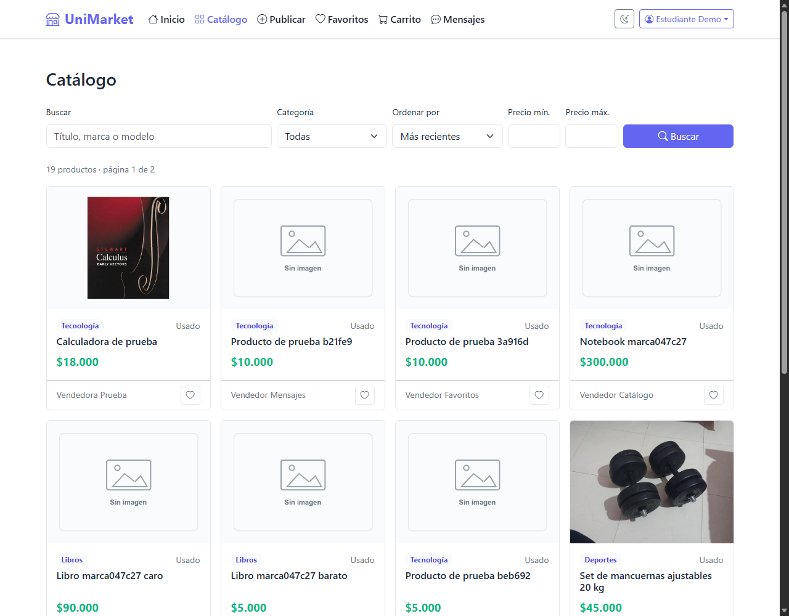
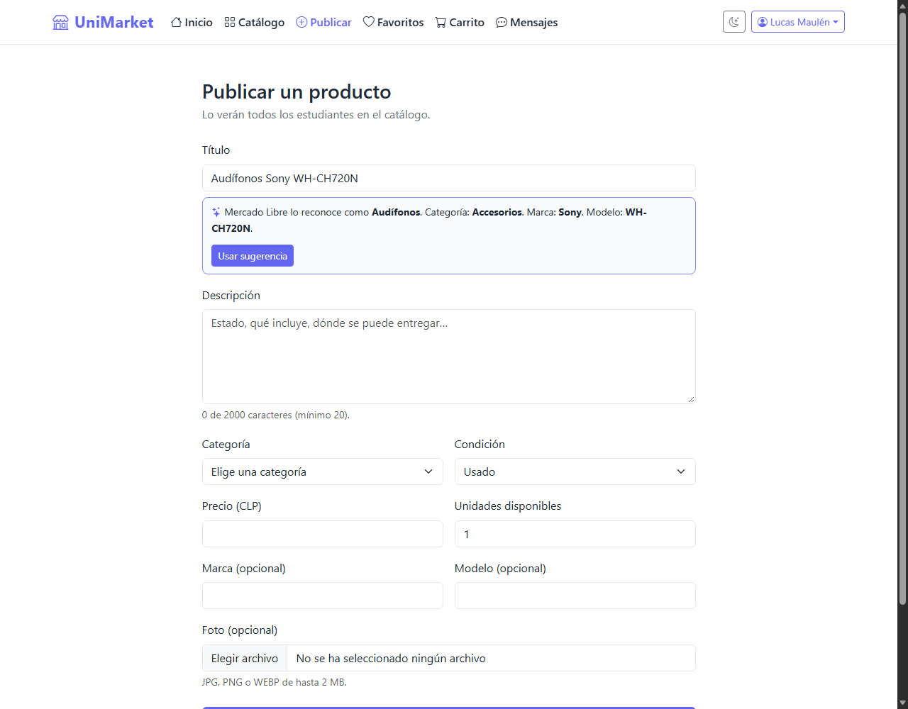
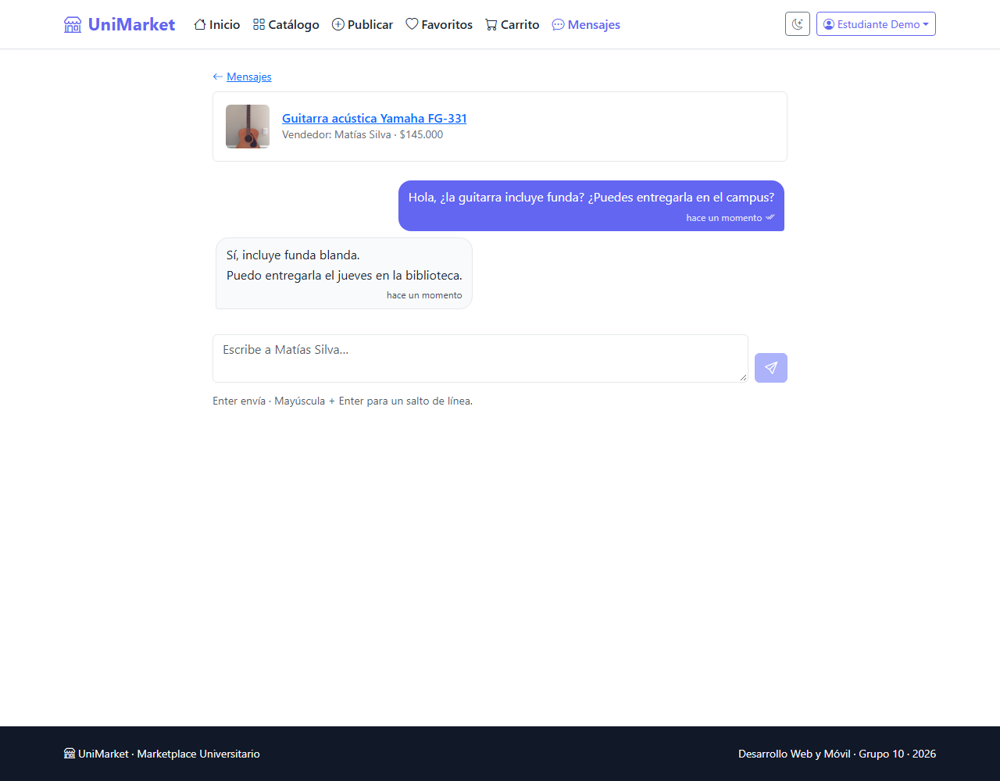
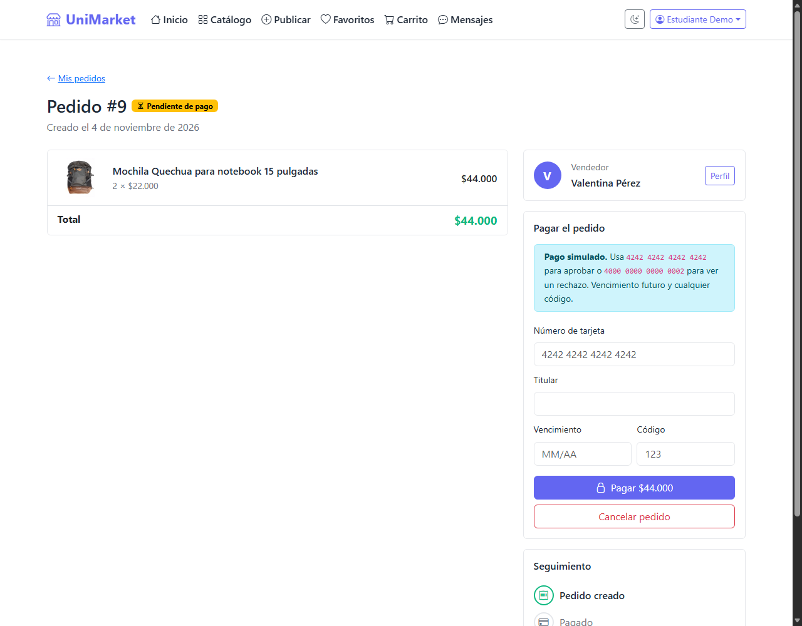
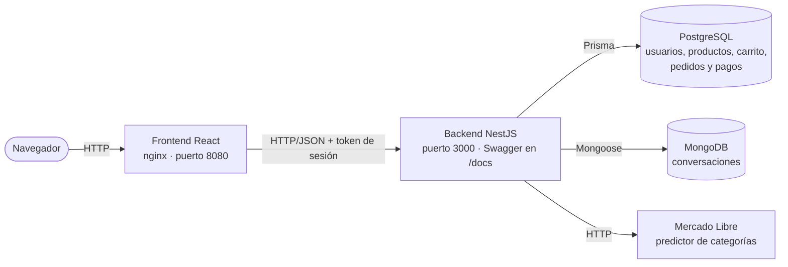
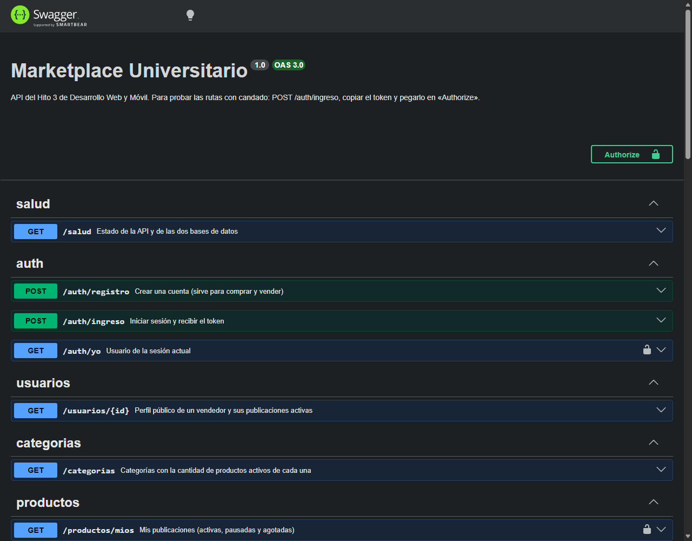

# UniMarket · Marketplace Universitario

Plataforma web para comprar y vender artículos usados dentro de la comunidad universitaria.
Hito 3 de Desarrollo Web y Móvil (segundo semestre 2026), **caso 3.4: Marketplace universitario**.



## Contenido

1. [Integrantes](#integrantes-grupo-10)
2. [Problema y usuarios](#problema-y-usuarios)
3. [Continuidad y qué se agregó en el Hito 3](#continuidad-y-qué-se-agregó-en-el-hito-3)
4. [Arquitectura](#arquitectura)
5. [Tecnologías](#tecnologías)
6. [Datos: PostgreSQL y MongoDB](#datos-postgresql-y-mongodb)
7. [API y Swagger](#api-y-swagger)
8. [API pública: Mercado Libre](#api-pública-mercado-libre)
9. [Cómo ejecutarlo](#cómo-ejecutarlo)
10. [Variables de entorno](#variables-de-entorno)
11. [Pruebas](#pruebas)
12. [Limitaciones conocidas](#limitaciones-conocidas)
13. [Uso de inteligencia artificial](#uso-de-inteligencia-artificial)
14. [Cómo trabajamos](#cómo-trabajamos)

## Integrantes (Grupo 10)

| Nombre | GitHub | Historias | Parte del trabajo |
|---|---|---|---|
| Lucas Maulén Riquelme | [maudevdigital](https://github.com/maudevdigital) | HU-01 a HU-05: diseño, infraestructura, usuarios, base de React y publicaciones; integración y presentación | 35 % + presentación |
| Matías Catalán Ortega | [maticata011-bit](https://github.com/maticata011-bit) | HU-06, HU-07, HU-09 a HU-12: catálogo, pantallas de publicación, favoritos, carrito, pedidos y pago simulado | 35 % |
| Juan Soto Toledo | [JuanUnab-student](https://github.com/JuanUnab-student) | HU-08, HU-13 a HU-15: sugerencias de Mercado Libre, mensajes en MongoDB, pruebas y documentación | 20 % |

## Problema y usuarios

En la universidad la compraventa de cosas usadas (libros, calculadoras, notebooks, instrumentos,
bicicletas) está repartida en grupos de mensajería, redes sociales y murales. Eso hace difícil
buscar un producto, comparar precios, saber si sigue disponible y hablar con quien vende.

**UniMarket** lo junta en un solo lugar:

- **Quien vende** publica con foto, precio y stock, recibe preguntas y gestiona sus ventas.
- **Quien compra** busca y filtra, guarda favoritos, arma un carrito con productos de varios
  vendedores, paga (simulado) y sigue cada pedido.

Usuarios objetivo: estudiantes, y también funcionarios y docentes que quieran vender o comprar
dentro de la comunidad. Una misma cuenta sirve para comprar y vender.

## Continuidad y qué se agregó en el Hito 3

Este proyecto **reescribe el [Marketplace Universitario de la Actividad Evaluada 1](https://github.com/Matias2004-cmd/Proyecto-Marketplace-Universitario)**
(HTML, Bootstrap y JavaScript, con datos en arreglos y `localStorage`) como una plataforma completa.
En el Taller 2 el grupo trabajó otro caso (Metas UF); **para el Hito 3 el profesor indicó volver al
marketplace**, que corresponde al caso 3.4 del enunciado.

| Se conserva de la Actividad 1 | Cambia en el Hito 3 |
|---|---|
| Identidad visual: paleta, tema claro y oscuro | De JavaScript sin framework a React con componentes, páginas y servicios |
| Las 12 publicaciones, sus fotos y sus vendedores (ahora son datos iniciales de la base) | De arreglos y `localStorage` a PostgreSQL y MongoDB, a través de una API propia |
| Catálogo, filtros, favoritos, carrito y publicación | Cuentas de usuario, pedidos con estados, pago simulado, mensajes y sugerencias de Mercado Libre |

**Funcionalidades obligatorias del caso 3.4, todas implementadas:**

| Funcionalidad del enunciado | Cómo quedó |
|---|---|
| Usuarios y perfiles de comprador y vendedor | Registro, inicio de sesión, perfil público del vendedor; «Mis pedidos» y «Mis ventas» |
| Publicación y administración de productos | Publicar con foto, editar, pausar, eliminar (se archiva si ya se vendió) y «Mis publicaciones» |
| Categorías, búsqueda y filtros | Búsqueda por texto, categoría, rango de precio, orden y páginas, todo resuelto en el servidor |
| Favoritos y carrito | Guardados en la base; el carrito avisa si algo se agotó o se pausó y no deja pasar del stock |
| Creación y seguimiento de pedidos | Un pedido por vendedor, creado en una transacción que descuenta el stock; línea de tiempo del pedido |
| Estados de pedidos y transacciones simuladas | Pendiente → pagado → entregado, o cancelado (devuelve el stock); pago con tarjetas de prueba y comprobante |

Además: **mensajes entre comprador y vendedor** (MongoDB) y **sugerencias de categoría, marca y
modelo** al publicar (API pública de Mercado Libre).

| Publicar con sugerencia | Conversación | Detalle de un pedido |
|---|---|---|
|  |  |  |

## Arquitectura



- **React** muestra las pantallas y llama solo a nuestra API, siempre a través de
  `frontend/src/services/` (una función por operación).
- **El backend** concentra las reglas de negocio y los permisos. Cada recurso tiene su carpeta en
  `backend/src/` con controlador (rutas), servicio (reglas y acceso a datos) y esquemas de validación.
- **PostgreSQL** guarda lo transaccional; **MongoDB**, las conversaciones. Ninguna información se
  guarda en las dos bases.
- **Mercado Libre** se consulta desde el backend, nunca desde el navegador.

El detalle (estructura de carpetas, modelo entidad-relación, colección de MongoDB, todos los
endpoints y reglas de negocio) está en **[docs/arquitectura.md](docs/arquitectura.md)**. El diagnóstico
del punto de partida, las historias de usuario priorizadas y el mapa de navegación están en
**[docs/diseno.md](docs/diseno.md)**.

## Tecnologías

| Parte | Tecnología | Versión |
|---|---|---|
| Frontend | React · React Router · Vite · Bootstrap e íconos de Bootstrap | 19.3 · 7.18 · 8.3 · 5.3 |
| Backend | NestJS · class-validator · Swagger (`@nestjs/swagger`) | 11.2 · 0.14 · 11.4 |
| Base relacional | PostgreSQL con Prisma | 16 · 6.19 |
| Base documental | MongoDB con Mongoose | 7 · 8.24 |
| Pruebas | Jest (unitarias) y `node --test` (contra la API) | 30.5 · Node 24 |
| Ejecución | Docker Compose · Node.js · nginx | Compose v2 · 24 · 1.27 |

## Datos: PostgreSQL y MongoDB

**PostgreSQL (9 tablas):** `usuarios`, `categorias`, `productos`, `favoritos`, `items_carrito`,
`pedidos`, `detalles_pedido`, `pagos` y `equivalencias_categoria`. Tiene claves foráneas y
restricciones que protegen los datos aunque alguien se salte la API: precio mayor que cero, stock no
negativo, `subtotal = cantidad × precio`, comprador distinto del vendedor y **un solo pago aprobado
por pedido** (índice único parcial). Ver el [diagrama entidad-relación](docs/arquitectura.md#2-modelo-entidad-relación-postgresql).

Las tablas se crean con las migraciones de Prisma (`backend/prisma/migrations/`) y se llenan con
`backend/prisma/seed.js` (8 categorías, 9 vendedores, una cuenta de prueba, las cuentas del equipo,
12 productos y las equivalencias de Mercado Libre). Las dos cosas ocurren solas al levantar Docker y no duplican nada.

**MongoDB (colección `conversaciones`):** un documento por producto y comprador, con los mensajes
adentro. Se eligió el modelo documental porque:

1. una conversación se lee entera de una vez, y con los mensajes dentro es una sola lectura;
2. los mensajes solo se agregan, no se editan ni mueven dinero o stock, así que no necesitan
   transacciones ni claves foráneas;
3. es lo que más crece y es natural guardarlo como una lista dentro de cada conversación;
4. **no duplica PostgreSQL**: no existe tabla de mensajes. Solo se copia el título del producto para
   mostrar la bandeja sin consultar la otra base.

La bandeja y el número de mensajes sin leer los calcula MongoDB con agregaciones, y al abrir una
conversación se marcan como leídos solo los mensajes de la otra persona. Ver
[docs/arquitectura.md](docs/arquitectura.md#3-mongodb-colección-conversaciones-hu-13).

## API y Swagger

Con el proyecto levantado, la documentación interactiva está en **http://localhost:3000/docs**.
Para probar las rutas con candado: `POST /auth/ingreso` con un usuario de prueba, copiar el `token` de
la respuesta y pegarlo en el botón **Authorize**.

| Grupo | Rutas principales |
|---|---|
| Sesión y usuarios | `POST /auth/registro`, `POST /auth/ingreso`, `GET /auth/yo`, `GET /usuarios/:id` |
| Catálogo y publicaciones | `GET /categorias`, `GET /productos`, `GET /productos/:id`, `GET /productos/mios`, `POST`, `PATCH` y `DELETE /productos/:id` |
| Sugerencias | `GET /sugerencias/producto?titulo=` |
| Favoritos y carrito | `/favoritos`, `/carrito`, `/carrito/items/:productoId` |
| Pedidos y pagos | `POST /pedidos`, `GET /pedidos`, `GET /pedidos/:id`, `POST /pedidos/:id/pago`, `/entrega`, `/cancelacion` |
| Mensajes | `GET /conversaciones`, `GET /conversaciones/no-leidos`, `POST /conversaciones`, `GET /conversaciones/:id`, `POST /conversaciones/:id/mensajes` |
| Estado | `GET /salud` (dice si las dos bases están conectadas) |

Todos los errores tienen la misma forma, en español y sin detalles internos:
`{ "estado": 409, "mensaje": "Solo queda 1 unidad." }`.
Códigos: 400 datos inválidos · 401 sin sesión · 402 pago rechazado · 403 sin permiso · 404 no existe ·
409 conflicto de stock o de estado · 422 regla de negocio (por ejemplo, comprar lo propio) ·
503 Mercado Libre no disponible.



## API pública: Mercado Libre

| | |
|---|---|
| **Servicio** | Predictor de categorías de Mercado Libre Chile (sin clave ni registro) |
| **Documentación** | https://developers.mercadolibre.cl/es_ar/categoriza-productos |
| **Endpoints (los dos `GET`)** | `/sites/MLC/domain_discovery/search?limit=1&q={título}` (qué producto es, con marca y modelo) · `/categories/{id}` (categoría principal, solo cuando el tipo de producto no está en nuestra tabla) |
| **Qué se consume** | La categoría que reconoce Mercado Libre (por ejemplo «Audífonos») y la marca y el modelo si vienen en el título |
| **Dónde se usa** | En «Publicar»: mientras se escribe el título aparece la categoría, la marca y el modelo reconocidos. «Usar sugerencia» los copia al formulario y el vendedor los puede corregir |
| **Desde dónde** | Desde el **backend** (`GET /sugerencias/producto`) |

**Por qué aporta:** reconoce cualquier tipo de producto en español de Chile, no solo libros. Así una
publicación queda en la categoría correcta y con marca y modelo, lo que mejora la búsqueda y los
filtros del catálogo y ahorra tiempo al publicar. Lo probamos con notebooks, escritorios, chaquetas,
audífonos, calculadoras, bicicletas, mancuernas y guitarras.

**Lo que no completa, a propósito:** el precio, la descripción y la foto. Los pone el vendedor porque
dependen del estado real del objeto usado (una foto de catálogo mostraría un producto que no es el
que se vende). Además, las fotos y precios de Mercado Libre piden cuenta y token.

**Por qué desde el backend y no desde React:**

1. la categoría de Mercado Libre se traduce a las nuestras con la tabla `equivalencias_categoria`,
   en dos niveles: primero el tipo de producto (`MLC-HEADPHONES` → Accesorios) y, si no está, la
   categoría principal de Mercado Libre, que se pide aparte (`MLC1574` «Hogar y Muebles» → Hogar y
   muebles). Si nada calza, se sugiere «Otros», así **cualquier producto reconocido recibe categoría**;
2. las respuestas quedan una hora en memoria: el mismo título no se vuelve a consultar;
3. si Mercado Libre falla o tarda más de 4 segundos, respondemos un 503 con un mensaje claro y el
   formulario se sigue llenando a mano. Publicar nunca depende de Mercado Libre.

No hay claves ni secretos: el servicio es público.

## Cómo ejecutarlo

Requisito: **Docker Desktop** abierto.

```bash
git clone https://github.com/maudevdigital/marketplace-universitario.git
cd marketplace-universitario
cp .env.example .env
docker compose up --build
```

| Servicio | Dirección | Detalle |
|---|---|---|
| Aplicación web | http://localhost:8080 | React servido por nginx |
| API | http://localhost:3000 | NestJS |
| Swagger | http://localhost:3000/docs | Documentación interactiva |
| PostgreSQL | `localhost:5433` | Usuario y clave en `.env` (5433 para no chocar con un PostgreSQL local) |
| MongoDB | `localhost:27018` | Base `marketplace` |

Al arrancar, el backend aplica las migraciones y carga los datos iniciales. Para apagar todo sin
perder nada: `docker compose down`. **Ojo con `docker compose down -v`:** la `-v` borra la base de datos
completa (cuentas creadas a mano, publicaciones, pedidos y mensajes); úsenla solo para volver a los
datos iniciales.

**Usuarios de prueba** (todos con la contraseña `Clave1234`, datos ficticios):

| Correo | Para qué |
|---|---|
| `lucas.maulen@alumnos.cl`, `matias.catalan@alumnos.cl`, `juan.soto@alumnos.cl` | Las cuentas del equipo: existen siempre, aunque se reinicie la base |
| `demo@alumnos.cl` | Comprar (no tiene publicaciones) |
| `matias.silva@alumnos.cl` | Vende la guitarra (stock 1: sirve para probar el agotado) |
| `tomas.herrera@alumnos.cl` | Vende la bicicleta (stock 3) |
| `camila.rojas@alumnos.cl`, `diego.fuentes@alumnos.cl`… | Los demás vendedores de la Actividad 1 |

**Tarjetas de prueba:** `4242 4242 4242 4242` se aprueba y `4000 0000 0000 0002` se rechaza (con
vencimiento futuro, por ejemplo `12/28`, y cualquier código de 3 dígitos).

### Demostración en 5 minutos

1. Ingresar como `demo@alumnos.cl`, buscar «guitarra» en el catálogo y abrirla.
2. «Preguntar al vendedor». Ingresar en otra ventana como `matias.silva@alumnos.cl`: aparece un
   número rojo en «Mensajes». Responder.
3. Con `demo`, agregar la guitarra y la mochila al carrito y confirmar: se crean dos pedidos, uno por
   vendedor, y la guitarra queda agotada.
4. Pagar un pedido con la tarjeta rechazada (402, el pedido sigue pendiente) y luego con la aprobada.
5. Cancelar el otro pedido: el stock vuelve.
6. Publicar un producto escribiendo «Audífonos Sony WH-CH720N» y pulsar «Usar sugerencia».
7. En Swagger, ejecutar `GET /productos?q=casio`.

### Desarrollo sin reconstruir las imágenes

```bash
docker compose up -d postgres mongo

cd backend
cp .env.example .env
npm install
npx prisma migrate deploy
npx prisma db seed
npm run start:dev          # http://localhost:3000

cd ../frontend
cp .env.example .env.local
npm install
npm run dev                # http://localhost:5173
```

## Variables de entorno

Nunca se suben archivos `.env` reales: el repositorio solo trae los `.env.example`.

| Archivo | Variable | Para qué |
|---|---|---|
| `.env` (raíz, Docker Compose) | `POSTGRES_USER`, `POSTGRES_PASSWORD`, `POSTGRES_DB` | Usuario, clave y nombre de la base PostgreSQL |
| | `JWT_SECRET` | Frase con la que se firman las sesiones (obligatoria: sin ella la API no arranca) |
| `backend/.env` (solo sin Docker) | `DATABASE_URL`, `MONGO_URI` | Conexión a PostgreSQL y MongoDB |
| | `JWT_SECRET`, `JWT_EXPIRA` | Firma y duración de la sesión (`8h`) |
| | `PORT`, `CORS_ORIGEN` | Puerto de la API y direcciones del frontend que la pueden llamar |
| | `IMAGENES_DIR` | Carpeta de las fotos que suben los usuarios |
| | `MERCADO_LIBRE_URL` | Opcional: dirección de Mercado Libre (sirve para simular que no responde) |
| `frontend/.env.local` (solo sin Docker) | `VITE_API_URL` | Dirección de la API que usa el navegador |

## Pruebas

**Unitarias** (Jest, sin base de datos, unos segundos): reglas de negocio con la base simulada.

```bash
cd backend
npm test
```

42 pruebas en 4 archivos de `backend/test/unitarias/`:

- compra «todo o nada» y un pedido por vendedor;
- pago aprobado, rechazado, vencido y doble;
- entrega y cancelación con devolución de stock;
- dueño de la publicación y estado según el stock;
- sugerencias de Mercado Libre: traducción en dos niveles, respaldo «Otros», memoria y caída del servicio;
- permisos de las conversaciones;
- mensajes de validación.

**Contra la API levantada** (`node --test`, con Docker arriba): 33 pruebas en
`backend/test/api/` que recorren cada flujo de punta a punta. Cada prueba crea sus propios usuarios y
productos, así que se pueden repetir sin reiniciar la base.

```bash
docker compose up -d
cd backend
npm run test:api
```

Incluyen el caso más delicado: **dos personas comprando la última unidad al mismo tiempo**, cinco
veces seguidas. Siempre una compra y la otra recibe 409; el stock nunca queda negativo.

**Manuales:** todas las pantallas se revisaron en el navegador, con y sin sesión, en tema claro y
oscuro y en pantalla angosta. Las capturas están en [docs/capturas/](docs/capturas/).

## Limitaciones conocidas

- **Pago simulado:** no hay conexión con ningún medio de pago real; solo funcionan las dos tarjetas
  de prueba y los datos de tarjeta nunca se guardan.
- **Mensajes sin tiempo real:** la conversación abierta se actualiza cada 10 segundos y el número de
  no leídos cada 30, en vez de usar una conexión permanente.
- **Mercado Libre:** si cierra el acceso público a su predictor (ya lo hizo con su buscador), las
  sugerencias responden 503 y se publica a mano. Con títulos de una sola palabra a veces se equivoca
  («guitarra» la toma como juguete; «guitarra acústica yamaha» acierta): por eso la sugerencia nunca
  se aplica sola y el vendedor la confirma.
- **Imágenes en disco:** las fotos subidas se guardan en un volumen de Docker, no en un servicio de
  archivos en la nube.
- **Sin recuperación de contraseña** ni verificación de correo.
- **Entregas en persona:** no se calcula despacho; el lugar de entrega se acuerda por mensajes.

## Uso de inteligencia artificial

Usamos **Claude Code** como apoyo en orientación, estructura del código y documentación. También ayudó a
escribir y corregir partes del código; todo lo revisamos y probamos antes de integrarlo.

| Herramienta | Propósito | Prompt de ejemplo | Resultado | Validación humana | Aprendizaje |
|---|---|---|---|---|---|
| Claude Code | Orientación | «Revisa el enunciado y propón el modelo de datos» | Propuesta de tablas y endpoints | La ajustamos con la clase del profesor | Diseñar los datos antes de programar |
| Claude Code | Estructura del código | «Arma la estructura del backend y del frontend» | Módulos en NestJS y páginas en React | Probamos cada flujo en el navegador | Separar responsabilidades |
| Claude Code | Documentación | «Completa el README según el enunciado» | Borrador del README | Lo corregimos y completamos | Documentar mientras se trabaja |

## Cómo trabajamos

- `main` solo recibe la versión final desde `develop`.
- Cada historia en su rama (`feature/hu-06-catalogo`) y entra a `develop` por Pull Request revisado
  por otra persona.
- Commits en español y descriptivos: `feat(pedidos): descuenta stock en una transacción`.
- Plan, reparto y contrato de datos: [docs/arquitectura.md](docs/arquitectura.md).
