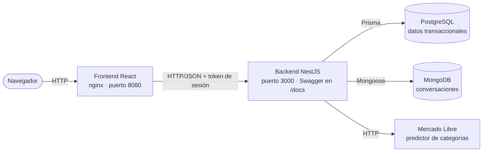
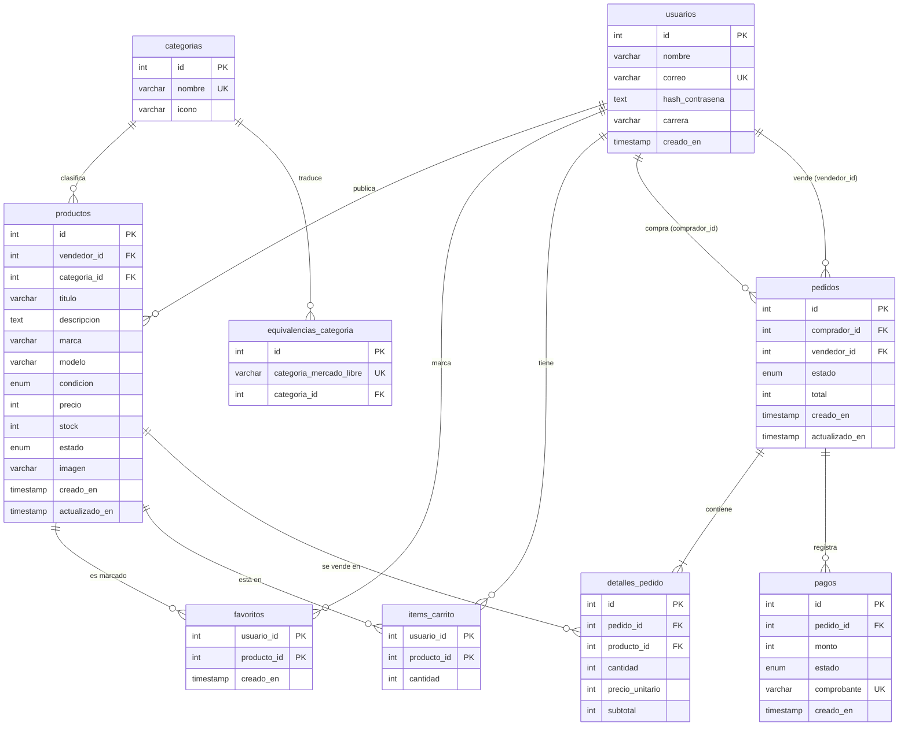

# Arquitectura y contrato de datos (HU-01)

Este documento es el **contrato del equipo**: modelo de datos, colección de MongoDB, endpoints y
reglas de negocio. Si alguien necesita cambiar algo de aquí, lo avisa a los tres antes de programarlo.

## 1. Componentes



| Componente | Tecnología | Responsabilidad |
|---|---|---|
| Frontend | React 19 + Vite + React Router + Bootstrap 5 | Pantallas, formularios, estados de carga, error y vacío; consume solo nuestra API |
| Backend | NestJS 11 | Reglas de negocio, validaciones, permisos y coordinación de las dos bases |
| PostgreSQL 16 | Prisma 6 | Usuarios, productos, carrito, favoritos, pedidos y pagos simulados |
| MongoDB 7 | Mongoose 8 | Conversaciones entre comprador y vendedor |
| API pública | Mercado Libre | Sugerir categoría, marca y modelo al publicar (HU-08) |
| Documentación | Swagger (`@nestjs/swagger`) | Contrato interactivo en `/docs` |
| Ejecución | Docker Compose | Levanta los cuatro servicios con un comando |

### Estructura del backend

Un módulo por recurso, cada uno con su controlador (rutas), servicio (reglas y acceso a datos) y
esquemas de validación (`dto/`). Lo compartido vive en `src/comun/`:

| Archivo | Para qué sirve |
|---|---|
| `comun/filtro-errores.ts` | Formato único de error `{ estado, mensaje }`; nunca expone detalles internos |
| `comun/validacion.ts` | Validación global con mensajes en español |
| `comun/id.pipe.ts` | `@Param('id', IdPipe)`: valida identificadores numéricos |
| `comun/imagenes.ts` | Subida de imágenes (JPG, PNG o WEBP, hasta 2 MB) |
| `comun/prisma/` | Conexión única a PostgreSQL (`PrismaService`, global) |
| `auth/sesion.ts` | `GuardiaSesion` para rutas con candado y `@UsuarioActual()` |
| `productos/productos.service.ts` | `camposProductoPublico`: la forma en que un producto sale de la API |

### Estructura del frontend

| Carpeta | Contenido |
|---|---|
| `src/pages/` | Una página por ruta |
| `src/components/` | Piezas reutilizables: `Cargando`, `MensajeError`, `EstadoVacio`, `TarjetaProducto`, `RutaProtegida`… |
| `src/services/` | Todas las llamadas al backend; usan `pedir()` de `api.js` |
| `src/hooks/` | `usePeticion` (datos + cargando + error + recargar), `useSesion`, `useAvisos`, `useTema` |
| `src/context/` | Sesión y avisos compartidos |
| `src/styles/tema.css` | Paleta y tema oscuro de la Actividad 1; nada de colores escritos a mano |

## 2. Modelo entidad-relación (PostgreSQL)



**Restricciones** (además de claves primarias, foráneas y únicas), definidas en
`backend/prisma/migrations/20261104120000_inicial/migration.sql`:

| Tabla | Restricción |
|---|---|
| `productos` | `precio > 0`, `stock >= 0`; `estado` ∈ {activo, pausado, agotado, eliminado}; `condicion` ∈ {nuevo, como_nuevo, usado} |
| `items_carrito` | `cantidad > 0` |
| `pedidos` | `total >= 0`; `comprador_id <> vendedor_id`; `estado` ∈ {pendiente, pagado, entregado, cancelado} |
| `detalles_pedido` | `cantidad > 0`, `precio_unitario > 0`, `subtotal = cantidad × precio_unitario` |
| `pagos` | `monto > 0`; **un solo pago aprobado por pedido** (índice único parcial) |

Decisiones:

- Un usuario es comprador y vendedor a la vez: el «perfil» depende de la vista.
- Un carrito con productos de dos vendedores genera **dos pedidos**, uno por vendedor.
- `precio_unitario` se copia al comprar: un cambio de precio posterior no altera los pedidos hechos.
- Un producto con pedidos no se borra: pasa a `eliminado` y sale del catálogo, carritos y favoritos.
- Borrar un producto sin pedidos borra en cascada sus favoritos y sus ítems de carrito.

## 3. MongoDB: colección `conversaciones` (HU-13)

```json
{
  "_id": "…",
  "productoId": 9,
  "productoTitulo": "Guitarra acústica Yamaha FG-331",
  "compradorId": 10,
  "vendedorId": 7,
  "mensajes": [
    { "autorId": 10, "texto": "¿Incluye funda?", "enviadoEn": "2026-11-10T14:02:00Z", "leido": true },
    { "autorId": 7, "texto": "Sí, una funda blanda.", "enviadoEn": "2026-11-10T14:05:00Z", "leido": false }
  ],
  "ultimoMensajeEn": "2026-11-10T14:05:00Z",
  "creadoEn": "2026-11-10T14:02:00Z"
}
```

Índices: único en (`productoId`, `compradorId`); (`vendedorId`, `ultimoMensajeEn`) y
(`compradorId`, `ultimoMensajeEn`) para las bandejas.

**Por qué documental y no relacional:**

1. Una conversación se lee entera de una vez: con los mensajes dentro del documento es una sola lectura, sin uniones.
2. Los mensajes solo se agregan; no se editan ni participan en transacciones de dinero o stock.
3. Es lo que más crece y no necesita claves foráneas estrictas.
4. **No duplica PostgreSQL**: no existe tabla de mensajes. Solo se copia `productoTitulo` para mostrar la bandeja sin consultar la otra base.

## 4. Endpoints

🔒 = necesita `Authorization: Bearer <token>`. Errores siempre como `{ "estado": 409, "mensaje": "…" }`.

| Método | Ruta | Para qué | Historia | Estado |
|---|---|---|---|---|
| GET | `/salud` | Estado de la API y de las dos bases | HU-02 | ✅ |
| POST | `/auth/registro` | Crear cuenta | HU-03 | ✅ |
| POST | `/auth/ingreso` | Iniciar sesión y recibir el token | HU-03 | ✅ |
| GET 🔒 | `/auth/yo` | Usuario de la sesión | HU-03 | ✅ |
| GET | `/usuarios/:id` | Perfil público y publicaciones activas | HU-03 | ✅ |
| GET | `/categorias` | Categorías con cantidad de productos activos | HU-05 | ✅ |
| GET 🔒 | `/productos/mios` | Mis publicaciones | HU-05 | ✅ |
| POST 🔒 | `/productos` | Publicar (multipart, con imagen opcional) | HU-05 | ✅ |
| PATCH 🔒 | `/productos/:id` | Editar lo propio; `estado` solo activo o pausado | HU-05 | ✅ |
| DELETE 🔒 | `/productos/:id` | Eliminar lo propio (se archiva si tiene pedidos) | HU-05 | ✅ |
| GET | `/productos` | Catálogo: `q`, `categoria`, `precioMin`, `precioMax`, `orden`, `pagina` | HU-06 | |
| GET | `/productos/:id` | Detalle con datos del vendedor | HU-06 | |
| GET 🔒 | `/sugerencias/producto?titulo=` | Autocompletar con Mercado Libre | HU-08 | |
| GET · POST · DELETE 🔒 | `/favoritos`, `/favoritos/:productoId` | Favoritos | HU-09 | |
| GET · POST · PATCH · DELETE 🔒 | `/carrito`, `/carrito/items/:productoId` | Carrito con tope de stock | HU-10 | |
| POST · GET 🔒 | `/pedidos`, `/pedidos?rol=comprador\|vendedor`, `/pedidos/:id` | Comprar y seguir pedidos | HU-11 | |
| POST 🔒 | `/pedidos/:id/pago`, `/pedidos/:id/entrega`, `/pedidos/:id/cancelacion` | Estados y pago simulado | HU-12 | |
| GET · POST 🔒 | `/conversaciones`, `/conversaciones/:id`, `/conversaciones/:id/mensajes` | Mensajes | HU-13 | |

Códigos: 400 datos inválidos · 401 sin sesión · 403 no es el dueño · 404 no existe ·
409 conflicto de stock o de estado · 422 regla de negocio (por ejemplo, comprar lo propio) ·
503 servicio externo caído.

## 5. Reglas de negocio

| Regla | Dónde | Respuesta |
|---|---|---|
| Solo el dueño edita o elimina una publicación | `ProductosService` | 403 ✅ |
| Con stock 0 la publicación pasa a «agotado»; con stock vuelve a activo salvo que esté pausada | `ProductosService` | ✅ |
| Publicar exige stock ≥ 1, precio > 0 y descripción de 20 caracteres o más | `CrearProductoDto` | 400 ✅ |
| No se compra más que el stock (en el carrito y de nuevo al comprar) | Carrito y pedidos | 409 |
| El stock se descuenta en una transacción: si un producto falla, no se crea ningún pedido | `PedidosService` | 409 |
| Nadie compra ni pregunta por su propio producto | Carrito, pedidos, conversaciones | 422 |
| Estados: pendiente → pagado → entregado; cancelado solo desde pendiente o pagado | `PedidosService` | 409 |
| Cancelar devuelve el stock y reactiva lo agotado | `PedidosService` | — |
| Pago simulado: `4242 4242 4242 4242` se aprueba, `4000 0000 0000 0002` se rechaza | `PagosService` | 402 |
