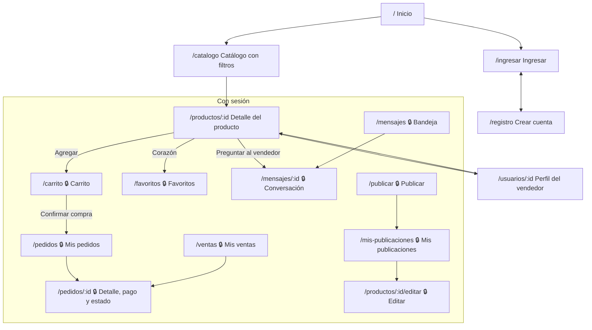

# Diagnóstico, historias y navegación (HU-01)

Complementa [arquitectura.md](arquitectura.md), donde están el modelo de datos, la colección de
MongoDB, los endpoints y las reglas de negocio. Aquí está lo que pide la sección 6 del enunciado y
que no cabe allá: de dónde partimos, qué historias se priorizaron y cómo se navega la página.

## 1. Diagnóstico del punto de partida

El punto de partida es el [Marketplace Universitario de la Actividad Evaluada 1](https://github.com/Matias2004-cmd/Proyecto-Marketplace-Universitario),
porque el profesor indicó trabajar el caso 3.4 en el Hito 3.

| Qué tenía | Limitación | Qué se reutiliza |
|---|---|---|
| Catálogo con 12 productos, filtros y búsqueda | Los productos estaban escritos en un arreglo de JavaScript: nadie podía publicar de verdad | Los 12 productos, sus fotos y sus vendedores pasan a ser datos iniciales de PostgreSQL |
| Favoritos y carrito | Guardados en `localStorage`: se perdían al cambiar de navegador y no tenían dueño | Las mismas acciones, ahora guardadas por usuario en la base |
| Formulario de publicación con validación | No guardaba nada en un servidor | Las mismas reglas de validación, repetidas en el backend |
| Paleta, tema claro y oscuro | — | Se copian tal cual en `frontend/src/styles/tema.css` |
| — | No había cuentas, pedidos, control de stock ni forma de hablar con el vendedor | Se agregan en el Hito 3 (historias de abajo) |

## 2. Actores

| Actor | Qué necesita |
|---|---|
| Visitante | Ver el catálogo, buscar y filtrar sin crear cuenta |
| Comprador | Guardar favoritos, armar un carrito, comprar, pagar (simulado), seguir sus pedidos y preguntar al vendedor |
| Vendedor | Publicar y administrar sus productos, ver sus ventas, marcar entregas y responder preguntas |

Una misma cuenta es compradora y vendedora a la vez: el «perfil» depende de la pantalla («Mis pedidos»
o «Mis ventas»).

## 3. Historias de usuario priorizadas

Prioridad **1** = sin ella no se cumple el caso 3.4 (funcionalidad obligatoria); **2** = obligatoria
por los requisitos técnicos del enunciado (API pública, MongoDB, pruebas, documentación).
El orden de trabajo sigue las dependencias: primero la base, después el comercio y al final el cierre.

| # | Como… | quiero… | para… | Prioridad | Funcionalidad del caso 3.4 |
|---|---|---|---|---|---|
| HU-01 | equipo | acordar el modelo de datos, los endpoints y la arquitectura | programar los tres sobre el mismo contrato | 1 | Todas |
| HU-02 | equipo | levantar todo con un comando y con datos de prueba | que cualquiera pueda ejecutarlo | 1 | Todas |
| HU-03 | visitante | crear una cuenta e iniciar sesión | comprar y vender con mi nombre | 1 | Usuarios y perfiles |
| HU-04 | usuario | una interfaz clara que avise cuando carga, falla o no hay datos | entender qué está pasando | 1 | Todas |
| HU-05 | vendedor | publicar, editar y eliminar mis productos con foto | ofrecer lo que ya no uso | 1 | Publicación y administración |
| HU-06 | comprador | buscar y filtrar por categoría y precio | encontrar rápido lo que necesito | 1 | Categorías, búsqueda y filtros |
| HU-07 | vendedor | ver y pausar mis publicaciones | administrar lo que tengo a la venta | 1 | Publicación y administración |
| HU-09 | comprador | guardar productos en favoritos | volver a ellos después | 1 | Favoritos y carrito |
| HU-10 | comprador | juntar productos en un carrito sin pasar del stock | comprar varios de una vez | 1 | Favoritos y carrito |
| HU-11 | comprador | confirmar el carrito y ver mis pedidos; como vendedor, ver mis ventas | seguir cada compra | 1 | Creación y seguimiento de pedidos |
| HU-12 | comprador | pagar (simulado) y, como vendedor, marcar la entrega o cancelar | que el pedido avance de estado | 1 | Estados y transacciones simuladas |
| HU-13 | comprador | preguntarle al vendedor por un producto y recibir respuesta | acordar la entrega antes de comprar | 2 | Persistencia NoSQL (conversaciones) |
| HU-08 | vendedor | que la categoría, la marca y el modelo se sugieran desde el título | publicar más rápido y bien clasificado | 2 | API pública |
| HU-14 | equipo | pruebas automáticas de las reglas de negocio | saber que nada se rompió | 2 | Pruebas |
| HU-15 | equipo | un README que explique cómo ejecutar y entender el proyecto | que el profesor lo pueda reproducir | 2 | Documentación |
| HU-16 | equipo | una presentación y una demostración ensayadas | defender las decisiones técnicas | 2 | Defensa |

## 4. Mapa de navegación

Las páginas con candado piden iniciar sesión; si no hay sesión, llevan a «Ingresar» y después vuelven
a donde iba la persona.

El menú superior lleva a Inicio, Catálogo, Publicar, Favoritos, Carrito, Mensajes (con el número de
no leídos) y al menú de la cuenta (Mi perfil público, Mis publicaciones, Mis pedidos, Mis ventas y
Salir).
