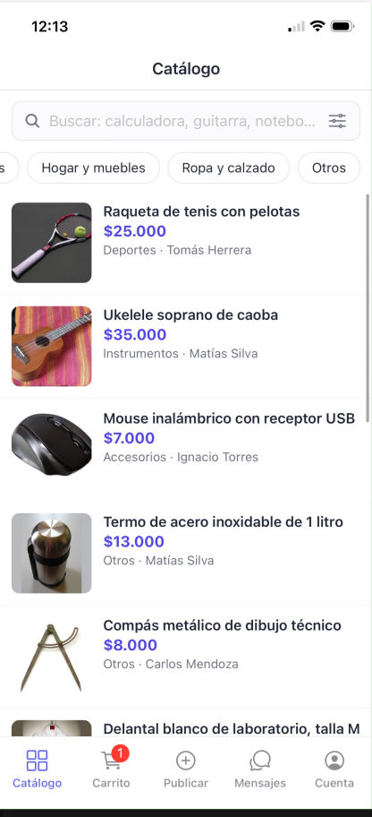
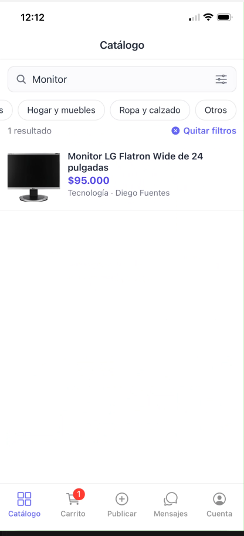
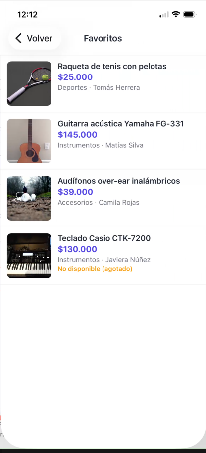
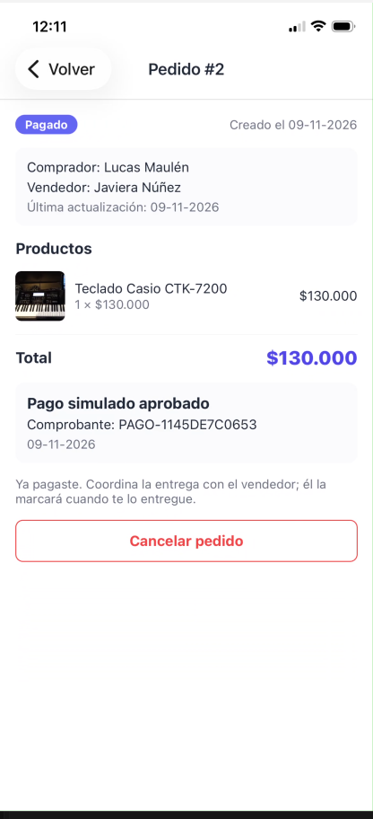
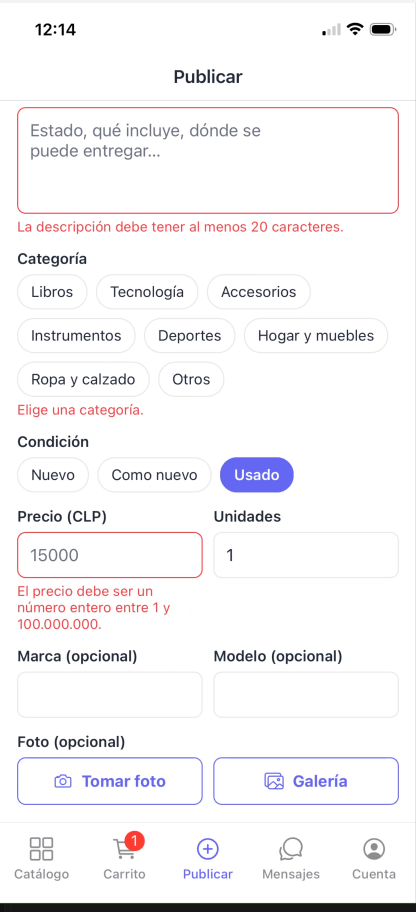
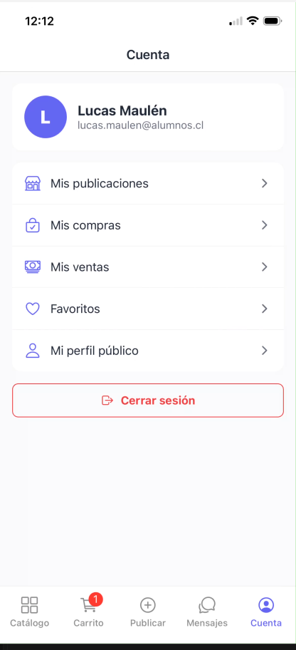
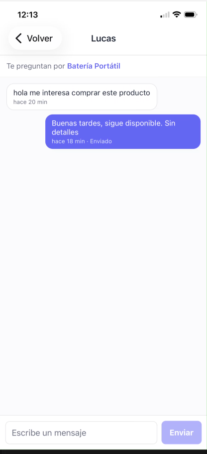

# UniMarket en el teléfono (Hito 4)

Aplicación móvil de UniMarket hecha con **React Native y Expo**. Es un segundo cliente del mismo
sistema del Hito 3: no tiene backend ni base de datos propios, todo lo pide a la **misma API REST**
que usa la web. Por eso un favorito guardado en el teléfono aparece en la web, y un pedido pagado
en la web aparece pagado en el teléfono.

```
Aplicación web (React)      Aplicación móvil (React Native)
            \                      /
             \   HTTP + JSON      /
              API REST (NestJS)
              /              \
       PostgreSQL           MongoDB
```

La aplicación nunca se conecta a PostgreSQL ni a MongoDB, y no trae datos escritos en el código:
todo lo que muestra viene de la API.

## Contenido

1. [Cómo ejecutarla](#cómo-ejecutarla)
2. [Dirección de la API](#dirección-de-la-api)
3. [Pantallas y flujos](#pantallas-y-flujos)
4. [Endpoints que usa](#endpoints-que-usa)
5. [Errores, validaciones y estados](#errores-validaciones-y-estados)
6. [Organización del código](#organización-del-código)
7. [Uso de inteligencia artificial](#uso-de-inteligencia-artificial)

## Cómo ejecutarla

Requisitos: Node 20 o superior, el backend del proyecto encendido y la aplicación **Expo Go** en el
teléfono (App Store o Google Play). El teléfono y el computador deben estar en la **misma red Wi-Fi**.

```bash
# 1. Encender el backend, las bases y la web (desde la raíz del repositorio)
cp .env.example .env
docker compose up -d --build

# 2. Instalar y encender la aplicación móvil
cd movil
npm install
npx expo start --lan
```

En la terminal aparece un código QR: se escanea con la cámara del iPhone (o desde Expo Go en
Android) y la aplicación se abre en el teléfono. Para entrar se puede usar cualquier cuenta de
prueba, por ejemplo `demo@alumnos.cl` con la contraseña `Clave1234`.

> Si el teléfono está en una red que aísla a los equipos (por ejemplo, el Wi-Fi de la
> universidad), conviene activar el punto de acceso del teléfono y conectar el computador a él.

## Dirección de la API

**No hay que escribir ninguna IP.** Expo ya sabe la dirección del computador (es desde donde el
teléfono bajó la aplicación), así que la app busca la API en esa misma dirección, puerto 3000
([`src/services/api.js`](src/services/api.js)).

Solo hace falta configurar algo en dos casos, copiando [`.env.example`](.env.example) a `.env.local`
y reiniciando Expo:

| Caso | Variable | Ejemplo |
|---|---|---|
| La API está en otro puerto (el mismo `PUERTO_API` del `.env` de la raíz) | `EXPO_PUBLIC_API_PUERTO` | `3001` |
| La API está en otra máquina | `EXPO_PUBLIC_API_URL` | `http://192.168.0.10:3000` |

En el teléfono, `localhost` es el propio teléfono, por eso nunca se usa `localhost` como dirección.

## Pantallas y flujos

La aplicación se organiza en cinco pestañas: **Catálogo, Carrito, Publicar, Mensajes y Cuenta**.
Desde Cuenta se abren mis publicaciones, mis compras, mis ventas, favoritos y el perfil.

| Catálogo | Búsqueda y filtros | Detalle de un producto |
|---|---|---|
|  |  |  |

| Favoritos | Mis compras | Detalle de un pedido |
|---|---|---|
|  |  |  |

| Publicar (validación) | Cuenta | Conversación |
|---|---|---|
|  |  |  |

### Flujos obligatorios del caso 3.4

1. **Explorar publicaciones y ver el detalle.** El catálogo muestra las publicaciones activas con foto,
   precio y vendedor; al tocar una se abre su detalle (descripción, estado, stock y vendedor).
2. **Buscar o filtrar y administrar favoritos.** Búsqueda por texto, categoría, rango de precio y orden.
   «Quitar filtros» vuelve a mostrar todo. En el detalle, «Guardar en favoritos» lo marca o lo quita, y
   la lista está en Cuenta → Favoritos.
3. **Consultar los pedidos propios y sus estados.** Cuenta → Mis compras (o Mis ventas) muestra cada
   pedido con su estado: pendiente de pago, pagado, entregado o cancelado. El detalle muestra los
   productos, el total y lo que se puede hacer según el estado.

### Además

- Carrito con tope de stock y compra (crea los pedidos).
- Pago simulado, marcar como entregado y cancelar.
- Publicar con foto de la cámara o la galería, con sugerencia de categoría y marca; editar, pausar y
  eliminar las propias publicaciones.
- Preguntar al vendedor y conversar (los mensajes se guardan en MongoDB).
- Números en las pestañas de Carrito y Mensajes, que se actualizan solos.

### Verificar que el cambio llega a la web

1. En el teléfono: abrir un producto y tocar **Guardar en favoritos** (`POST /favoritos/:id`).
2. En la web (`http://localhost:8080`, con la misma cuenta): abrir **Favoritos** y recargar.
3. El producto aparece: ambos clientes leen la misma tabla de PostgreSQL a través de la API.

## Endpoints que usa

Todas las llamadas pasan por un único módulo ([`src/services/servicios.js`](src/services/servicios.js)),
que usa [`src/services/api.js`](src/services/api.js) para agregar el token y traducir los errores.

| Funcionalidad | Método | Endpoint | Pantalla |
|---|---|---|---|
| Crear cuenta | POST | `/auth/registro` | Crear cuenta |
| Ingresar | POST | `/auth/ingreso` | Ingresar |
| Revisar la sesión guardada | GET | `/auth/yo` | Al abrir la app |
| Perfil de un vendedor | GET | `/usuarios/:id` | Vendedor |
| Categorías | GET | `/categorias` | Catálogo, Publicar |
| Buscar y filtrar productos | GET | `/productos?q=&categoria=&precioMin=&precioMax=&orden=&pagina=` | Catálogo |
| Detalle de un producto | GET | `/productos/:id` | Producto |
| Mis publicaciones | GET | `/productos/mios` | Mis publicaciones |
| Publicar (con foto) | POST | `/productos` | Publicar |
| Editar, pausar o reactivar | PATCH | `/productos/:id` | Editar, Mis publicaciones |
| Eliminar publicación | DELETE | `/productos/:id` | Mis publicaciones |
| Sugerencia de Mercado Libre | GET | `/sugerencias/producto?titulo=` | Publicar |
| Listar favoritos | GET | `/favoritos` | Favoritos, Producto |
| Guardar en favoritos | POST | `/favoritos/:productoId` | Producto |
| Quitar de favoritos | DELETE | `/favoritos/:productoId` | Producto, Favoritos |
| Ver el carrito | GET | `/carrito` | Carrito |
| Agregar al carrito | POST | `/carrito/items` | Producto |
| Cambiar cantidad | PATCH | `/carrito/items/:productoId` | Carrito |
| Quitar del carrito | DELETE | `/carrito/items/:productoId` | Carrito |
| Vaciar el carrito | DELETE | `/carrito` | Carrito |
| Comprar (crea los pedidos) | POST | `/pedidos` | Carrito |
| Mis compras o mis ventas | GET | `/pedidos?rol=comprador` o `?rol=vendedor` | Pedidos |
| Detalle de un pedido | GET | `/pedidos/:id` | Pedido |
| Pagar (simulado) | POST | `/pedidos/:id/pago` | Pedido |
| Marcar como entregado | POST | `/pedidos/:id/entrega` | Pedido (vendedor) |
| Cancelar | POST | `/pedidos/:id/cancelacion` | Pedido |
| Conversaciones | GET | `/conversaciones` | Mensajes |
| Mensajes sin leer | GET | `/conversaciones/no-leidos` | Pestaña Mensajes |
| Ver una conversación | GET | `/conversaciones/:id` | Conversación |
| Preguntar al vendedor | POST | `/conversaciones` | Producto |
| Responder | POST | `/conversaciones/:id/mensajes` | Conversación |

Son los mismos endpoints de la web; para el móvil no se agregó ni se cambió ninguno.

## Errores, validaciones y estados

- **Cargando, error y vacío** en cada pantalla ([`src/components/Estados.jsx`](src/components/Estados.jsx)):
  indicador de carga, mensaje con botón «Reintentar» y un mensaje cuando no hay resultados.
- **Sin conexión o servidor apagado:** si la petición no sale o el servidor no responde en 10 segundos
  (30 si se sube una foto), se muestra un mensaje claro en vez de quedarse cargando.
- **Errores del backend:** la app muestra el mensaje que envía la API, por ejemplo al pedir más
  unidades que el stock (409) o con datos inválidos (400). Si la sesión vence (401), vuelve a Ingresar.
- **Validaciones en los formularios** antes de enviar: título de 3 a 120 caracteres, precio y stock
  mayores que cero, correo y contraseña al crear la cuenta. Las mismas reglas las vuelve a revisar el
  backend.
- **Confirmaciones:** avisos al agregar al carrito, pagar, cancelar o eliminar, y preguntas antes de
  acciones que no se pueden deshacer.
- **Recargar:** deslizar hacia abajo en las listas vuelve a pedir los datos a la API.

## Organización del código

```
movil/src/
├── app/                 Pantallas (Expo Router: cada archivo es una ruta)
│   ├── (pestanas)/      Catálogo, Carrito, Publicar, Mensajes y Cuenta
│   ├── productos/[id]/  Detalle y edición de un producto
│   ├── pedidos/         Lista y detalle de pedidos
│   ├── mensajes/[id]    Conversación
│   └── ingresar, registro, favoritos, mis-publicaciones, usuarios/[id]
├── components/          Piezas reutilizables: tarjetas, formularios, estados, foto
├── context/             Sesión y contadores de las pestañas
├── hooks/               usePeticion (carga, error y recarga), useSesion, useContadores
├── services/            api.js (comunicación HTTP) y servicios.js (una función por endpoint)
└── tema.js              Colores, textos de estados y formato de precios
```

El token de la sesión se guarda cifrado en el teléfono con `expo-secure-store`.

## Uso de inteligencia artificial

Usamos **Claude Code** como apoyo en la orientación, la estructura de las pantallas y la documentación.
También ayudó a escribir y corregir partes del código; todo lo revisamos y lo probamos en un iPhone
real antes de integrarlo.

| Elemento | Cómo ayudó la inteligencia artificial | Qué revisó el equipo |
|---|---|---|
| Estructura de la app | Propuso separar pantallas, componentes y servicios, y la navegación con pestañas | Que cada flujo obligatorio se pudiera recorrer en el teléfono |
| Comunicación con la API | Ayudó a escribir el módulo único de peticiones y el manejo de errores | Que cada pantalla mostrara datos reales y los errores del backend |
| Problemas del iPhone | Ayudó a encontrar la causa de la barra superior transparente, del teclado que tapaba la pregunta y de la subida de fotos | Probamos cada arreglo en el iPhone duplicado en el computador |
| Documentación | Borrador de este archivo y de la tabla de endpoints | Lo corregimos y comprobamos contra el código |
